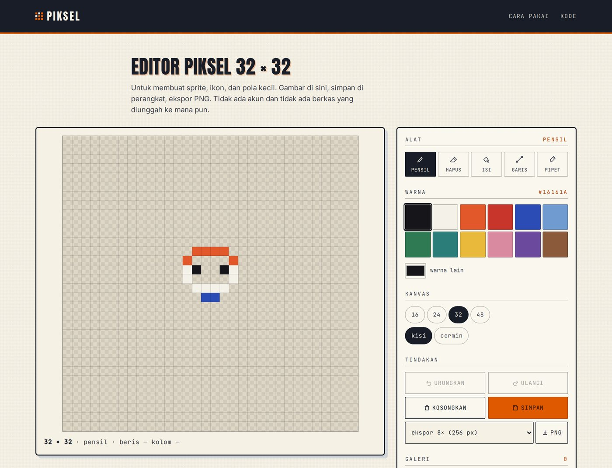

# Piksel — editor piksel 32 × 32

Editor piksel kecil yang berjalan sepenuhnya di peramban. Untuk membuat sprite, ikon,
dan pola kecil: gambar, simpan di perangkat, lalu ekspor PNG tanpa pengaburan.

[**Buka aplikasi →**](https://atmajadesna.github.io/piksel/)




## Latar Belakang

Membuat ikon kecil biasanya berarti membuka aplikasi berat, membuat kanvas besar, lalu
mengecilkannya — dan hasilnya kabur karena proses penyusutan. Piksel mengambil arah
sebaliknya: kanvasnya memang kecil (16 sampai 48 piksel), setiap piksel diletakkan
langsung, dan ekspor dilakukan dengan pembesaran bilangan bulat sehingga tidak ada
piksel yang setengah.

Tidak ada akun, tidak ada peladen, dan tidak ada berkas yang diunggah. Semua kerja
berlangsung di peramban dan tersimpan di `localStorage` perangkat.

## Fitur

- **Kanvas 16, 24, 32, 48** — perpindahan ukuran menyalin bagian yang muat, jadi karya
  tidak hilang saat kanvas diperbesar.
- **Lima alat** — pensil, penghapus, isi (flood fill), garis, dan pipet warna.
- **Cermin kiri–kanan** untuk membuat wajah atau badan yang simetris.
- **Kisi** yang bisa disembunyikan saat menilai hasil akhir.
- **Riwayat 60 langkah** dengan urungkan dan ulangi, termasuk untuk penghapusan kanvas.
- **Galeri perangkat** berisi 18 gambar terakhir, lengkap dengan gambar mini.
- **Ekspor PNG 1×, 8×, dan 16×** dengan pembesaran tanpa pengaburan.
- **Pintasan papan tombol** untuk semua alat, cermin, kisi, urungkan, dan simpan.

## Poin Teknis

**Satu kanvas, dua lapisan.** Gambar disimpan pada kanvas berukuran sama dengan jumlah
piksel (32 × 32 piksel asli), lalu diperbesar oleh CSS dengan `image-rendering: pixelated`.
Lapisan kedua di atasnya hanya dipakai untuk pratinjau alat garis; lapisan ini diberi
`pointer-events: none` supaya tidak mencuri klik.

**Riwayat sebagai potret, bukan perintah.** Setiap perubahan menyimpan salinan penuh
larik piksel. Untuk kanvas 48 × 48 itu 2.304 nilai, dan 60 langkah riwayat masih jauh di
bawah batas penyimpanan peramban. Pendekatan ini menghapus seluruh kelas bug yang muncul
pada riwayat berbasis perintah terbalik.

**Isi area tanpa rekursi.** Flood fill memakai tumpukan eksplisit, bukan fungsi rekursif,
supaya kanvas 48 × 48 tidak menyentuh batas kedalaman tumpukan panggilan.

**Garis Bresenham.** Alat garis memakai algoritma titik tengah Bresenham, sehingga garis
tetap rapat pada semua kemiringan — tanpa celah diagonal yang biasa muncul bila garis
digambar dengan interpolasi biasa.

**Pembesaran bilangan bulat saat ekspor.** Ekspor menggambar ulang kanvas ke kanvas luar
berukuran `ukuran × skala` dengan `imageSmoothingEnabled = false`. Hasilnya tajam di
kelipatan berapa pun, tanpa perlu pustaka pemrosesan gambar.

**Penyimpanan yang gagal dengan sopan.** Bila kuota `localStorage` penuh, penyimpanan
dibatalkan dan pengguna diminta menghapus satu gambar — bukan gagal diam-diam.

## Pintasan

| Tombol | Yang terjadi |
| --- | --- |
| `B` `E` `G` `L` `I` | Pensil, penghapus, isi, garis, pipet |
| `X` | Cermin kiri–kanan |
| `K` | Kisi |
| `Ctrl` / `⌘` + `Z` | Urungkan |
| `Ctrl` / `⌘` + `Shift` + `Z` | Ulangi |
| `Ctrl` / `⌘` + `S` | Simpan ke galeri |

## Menjalankan

Tidak ada proses build dan tidak ada dependensi. Berkas statis biasa:

```bash
python3 -m http.server 8000
# lalu buka http://127.0.0.1:8000
```

Membuka `index.html` langsung dari sistem berkas juga berfungsi.

## Struktur

```
piksel/
├── index.html      susunan halaman
├── tokens.css      warna, huruf, jarak, gerak
├── styles.css      tata letak dan komponen
├── app.js          kanvas, riwayat, galeri, ekspor
└── docs/
    └── screenshot.jpg
```

## Lisensi

Kode berlisensi [MIT](LICENSE). Karya yang dibuat dengan aplikasi ini sepenuhnya milik
pembuatnya.
